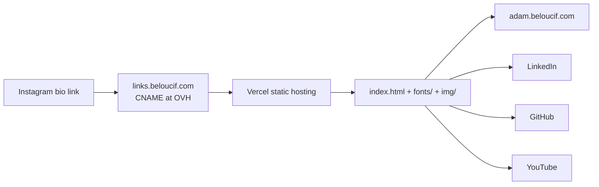

# adam-links

  

Personal link-in-bio page for the Instagram account `@_adam_blf`, served at
https://links.beloucif.com.

- Single static `index.html`, no build step, no JavaScript, no cookies, no analytics.
- Fonts: Newsreader (display) and Geologica (text), OFL, subset and self-hosted in `fonts/` (no CDN).
- Profile photo in `img/`, Reicon arrow inlined as an SVG symbol.
- Light and dark themes from the system preference.

## Architecture



## Legal

Personal, non-professional site: LCEN art. 6 III 2 only requires the host identity,
shown in the footer. No data is collected, so no privacy policy or cookie banner.
Adding a form, analytics or a third-party embed reopens that question.

## Deploy

```bash
vercel deploy --prod
```

Releases are tagged `vX.Y.Z` from `CHANGELOG.md`.
